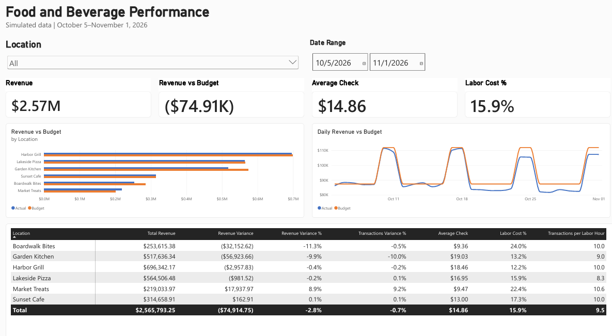
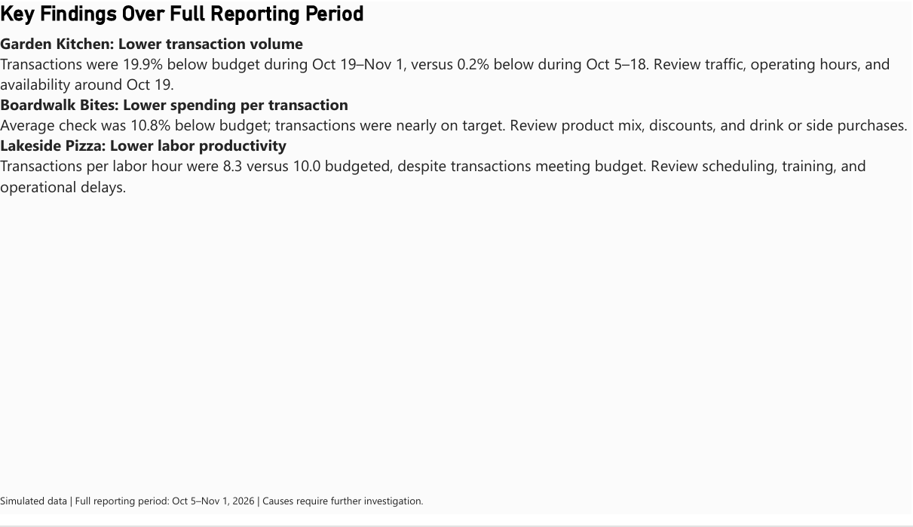
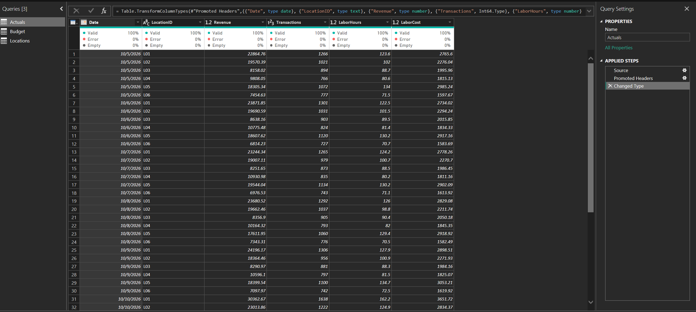
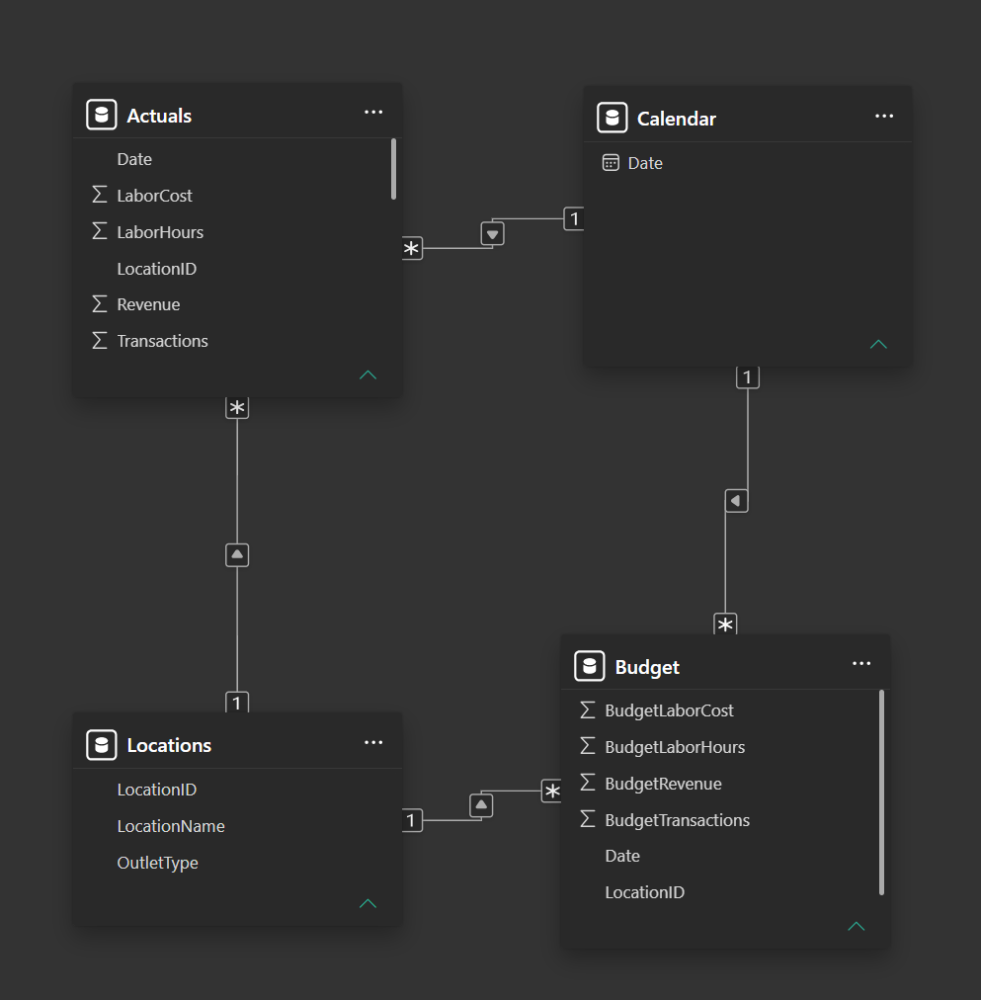

# Food & Beverage Performance Dashboard | Power BI

### Project Overview

An independent Power BI project analyzing financial and operational performance across six fictional food & beverage locations.

The dashboard compares actual results against budget, tracks daily performance, and highlights opportunities for further operational investigation.

**Tools:** Power BI Desktop, Power Query, DAX  
**Dataset:** Simulated operational data  
**Analysis Period:** October 5 – November 1, 2026  
**Locations:** 6

## Dashboard Preview

### Key Findings

## Business Questions

- Which locations are exceeding or falling short of revenue budgets?
- How are revenue and transaction volumes trending over time?
- Which locations demonstrate stronger labor efficiency?
- Where should management prioritize further investigation?

## Dashboard Features

- Revenue versus budget and variance analysis
- Daily revenue trends
- Location-level performance comparisons
- Transaction volume and average check
- Labor cost percentage
- Transactions per labor hour
- Interactive filters and performance tables

## Technical Implementation

### Data Preparation
Imported simulated CSV datasets into Power Query, assigned appropriate data types, and validated row counts, missing values, and errors.

### Power Query

Prepared the simulated operational datasets in Power Query before loading them into the Power BI model.

The project uses separate Actuals and Budget fact tables, supported by shared Calendar and Locations dimensions.

The completed PBIX file includes the Power Query steps for technical review.

### Data Modeling
Built a relational model using four tables:

- Calendar
- Locations
- Actuals
- Budget

Created four active one-to-many relationships connecting the shared Calendar and Locations dimensions to the Actuals and Budget fact tables.

### Data Model

### DAX
Developed 14 measures to calculate revenue, budget variances, transaction performance, average check, labor cost, and labor productivity.
**[View Selected DAX Measures](DAX_Measures.md)**

## Key Findings

- **Total Revenue:** $2,565,793.25, approximately 2.8% below budget.
- **Market Treats:** Exceeded revenue budget by 8.9%.
- **Garden Kitchen:** Finished 9.9% below its revenue budget.
- **Boardwalk Bites:** Finished 11.3% below its revenue budget.

These results highlight meaningful differences in performance across locations and provide starting points for management investigation.

## Project Files

- **Power BI (.pbix):** Editable report, data model, Power Query transformations, and DAX measures.
- **Dashboard PDF:** Finished report demonstrating the visual analysis.

## Data Disclaimer

This project uses entirely simulated data and fictional business locations. Results are intended to demonstrate business intelligence, financial analysis, data modeling, and reporting capabilities—not actual company performance.

## Author

Alexander Stearns  
[LinkedIn](https://www.linkedin.com/in/alexanderstearns1)
